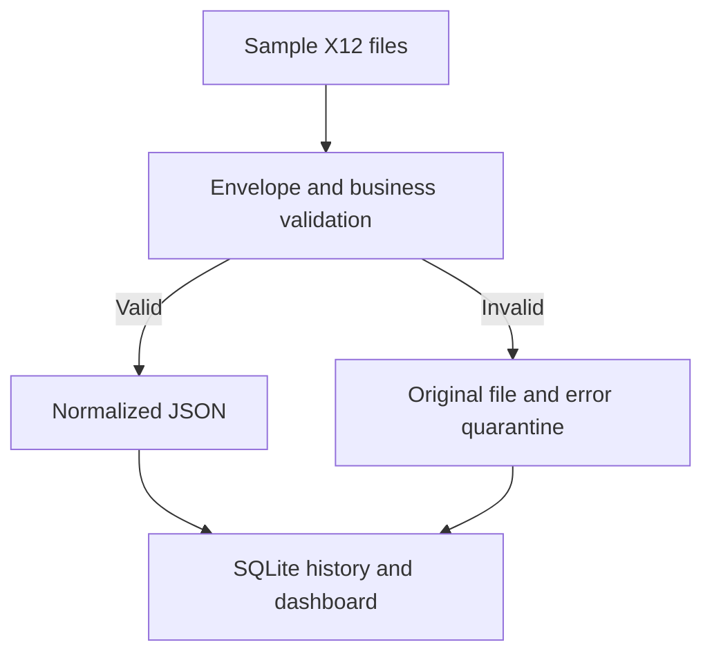
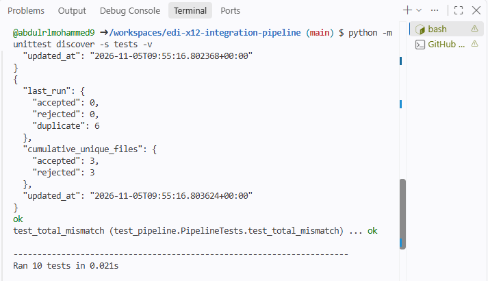
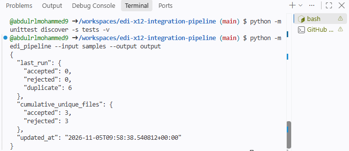

# X12 EDI Integration Pipeline

A runnable Python portfolio project that processes **synthetic X12 204 load tenders, 210 freight invoices, and 214 shipment status messages**. It demonstrates local ingestion, validation, JSON transformation, error quarantine, duplicate detection, and operational monitoring.

All partners, shipments, invoices, addresses, and amounts in the runnable pipeline are fictional. This is an independent demonstration inspired by common freight integration workflows; it contains no employer source code or production data.

## Professional project presentation

[Download the Project Ozark presentation (PowerPoint)](docs/presentations/Project-Ozark-Enterprise-Integration-and-IT-Modernization.pptx)

This 15-slide presentation describes Abdul Rahman Mohammed's reported EDI and data integration work supporting FedEx Freight through Accenture. It covers Cleo Integration Cloud (Studio and Cockpit), ANSI X12, SQL, Java, MFT protocols, Jenkins, ServiceNow, partner onboarding, mapping, incident investigation, and deployment validation. Case studies include rail-processing recovery, a Walmart 214 mapping enhancement, and 210 invoice performance investigation.

The deck provides professional experience context. The runnable code in this repository is an independent Python demonstration using synthetic data. Tools and production capabilities described in the presentation are not all implemented in this repository. Its architecture is identified as conceptual and sanitized; production case-study metrics are presenter-reported and are separate from the sample execution results documented below.

## Quick start

Requires Python 3.10 or later. No paid services, API keys, or runtime dependencies.

```bash
git clone https://github.com/abdulrlmohammed9/edi-x12-integration-pipeline.git
cd edi-x12-integration-pipeline
python -m edi_pipeline --input samples --output output
python -m unittest discover -s tests -v
```

On Windows, use `py` instead of `python` if needed. These commands work in PowerShell, a terminal, PyCharm, or GitHub Codespaces. Optional installation: `python -m pip install -e .`; then use `x12-pipeline` with the same arguments.

Open `output/dashboard.html` in a browser for monitoring. It is a static report regenerated after each run. No web server is required.

## Architecture



SHA-256 checks against SQLite skip previously processed identical bytes before validation. Original input files are left in place. Correct a rejected file in a separate input folder and rerun; changed bytes create a new history entry. To deliberately replay identical bytes for a demonstration, choose a new output folder.

## Implemented mappings

| Transaction | Input fields | JSON output |
|---|---|---|
| 204 | B202, B204, B206, S501/S502 | Carrier, shipment, payment method, stop sequence/reason |
| 210 | B302/B303/B306/B307/B311, C301 | Invoice, shipment, date, amount, carrier, currency |
| 214 | B1001–B1003, AT701/AT705–AT707 | Shipment, BOL, carrier, status, local event date/time/time code |

Invoice amounts use decimal arithmetic with B307 interpreted as implied cents. L305 must match B307. AT7 time codes are retained; timestamps are not converted to UTC because the sample profile does not resolve geographic time zones.

## Validation scope

The deliberately narrow demo profile accepts ASCII, test-only (`ISA15=T`), version 004010, one interchange containing one group and one transaction per file. It discovers separators from a fixed-width 106-character ISA header.

Checks include envelope nesting, required envelope occurrences, ISA/IEA, GS/GE and ST/SE control matching, SE segment count, GE/IEA counts, supported transaction and functional identifiers, required business segments/selected fields, valid invoice/event dates, nonnegative integer invoice cents, matching invoice totals, and the supported AT7 status subset X1/X3/X6/AF/D1.

This is **selected validation for a sample profile**, not complete X12 syntax or partner implementation-guide certification. Unmapped segments are not fully validated. Multiple interchanges/groups/transactions are rejected. Business identifier deduplication across different interchanges is not implemented; replay protection is byte based.

## Outputs

| Path | Purpose |
|---|---|
| `output/accepted/<sha256>.json` | Normalized business record plus provenance |
| `output/quarantine/<sha256>.edi` | Original rejected bytes |
| `output/quarantine/<sha256>.error.json` | Validation reason and provenance |
| `output/monitoring.sqlite` | Persistent unique-file processing history |
| `output/events.jsonl` | Accepted/rejected processing events |
| `output/summary.json` | Last-run counts and cumulative unique-file outcomes |
| `output/dashboard.html` | Outcome totals, file history, errors, latency, timestamps |

Run a valid-only batch with a nonzero exit on newly rejected files:

```bash
python -m edi_pipeline --input samples/valid --output output-valid --fail-on-rejection
```

A mixed sample batch intentionally includes rejected files and exits successfully unless `--fail-on-rejection` is supplied. Duplicate skips do not re-emit event log entries. Processing latency excludes final dashboard generation. Infrastructure failures such as unreadable inputs or unwritable outputs stop the command rather than misclassifying a file as invalid EDI.

## Verified demonstration

Locally verified on Python 3.12 on November 5, 2026:

- 10 automated tests passed.
- First mixed batch: **3 accepted, 3 rejected**.
- Repeated identical batch: **6 duplicates skipped**, no additional accepted records.
- Valid-only CLI batch: **3 accepted, 0 rejected**.

Tests cover the three mappings, alternate delimiters, malformed/truncated envelopes, missing business segments, invalid dates/status/amounts, mismatched totals/control counts, production/multiple-interchange rejection, quarantine artifacts, and persistent replay protection. GitHub Actions is configured for Python 3.10 and 3.12; local verification is distinct from hosted CI results.

## Execution evidence from GitHub Codespaces

The following user-captured artifacts document a sample-data run on **November 5, 2026**. Timestamps in the saved output files are UTC.

| Evidence | Observed result |
|---|---|
| [Initial batch event log](docs/evidence/events.jsonl) | Six unique files: three accepted (204/210/214) and three intentionally rejected |
| [Initial dashboard snapshot](docs/evidence/dashboard.html) | First-batch totals: 3 accepted, 3 rejected, 0 duplicates |
| [Replay summary](docs/evidence/summary.json) | Subsequent batch: 0 accepted, 0 rejected, 6 duplicates; cumulative history remains 3 accepted and 3 rejected |
| [Accepted 204 JSON record](docs/evidence/accepted-204.json) | Shipment LOAD1001, carrier DMOC, payment PP, and two mapped stops |
| Test terminal capture below | Shows 10 tests executed in 0.021 seconds; the final unittest status line is outside the screenshot |

The dashboard and summary were saved at different stages: the dashboard reflects the initial run at approximately 09:53 UTC, while the summary reflects the replay at approximately 09:58 UTC. These are complementary snapshots, not conflicting totals. The three expected rejection reasons are a segment-count mismatch, an unsupported demo status, and a control-number mismatch.

### Automated test execution



### Duplicate replay protection



### Accepted business record

Selected fields from the uploaded 204 output:

```json
{
  "transaction_type": "204",
  "shipment_id": "LOAD1001",
  "carrier_scac": "DMOC",
  "payment_method": "PP",
  "stops": [
    {"sequence": "1", "reason": "LD"},
    {"sequence": "2", "reason": "UL"}
  ]
}
```

The [complete accepted record](docs/evidence/accepted-204.json) also preserves envelope identifiers, the source filename, a SHA-256 digest, and the processing timestamp. All evidence contains synthetic demonstration data.

To view the saved dashboard, open its repository link, download the raw HTML file, and open it locally in a browser. GitHub's file viewer displays its source rather than running the dashboard. These files are preserved evidence snapshots; future local runs continue writing to the ignored `output/` folder. Python bytecode cache files (`.pyc`) are intentionally excluded from documentation evidence.

## Operational limits

Run one process per output directory. SQLite commits per file and atomic JSON replacement help local use, but file writes and database records are not one distributed transaction; this is not an exactly-once production system. The dashboard and history are unbounded for a small portfolio demonstration.

partner-configurable rules and full implementation-guide validation; multi-transaction splitting; business-key duplicate detection; 997/999 acknowledgments; SFTP/AS2 ingress; scheduled ingestion; alert thresholds; retention and retry policies; database/output transaction coordination; and optional cloud deployment. These integrations are not implemented or claimed as live capabilities.

## License

See [LICENSE](LICENSE).
